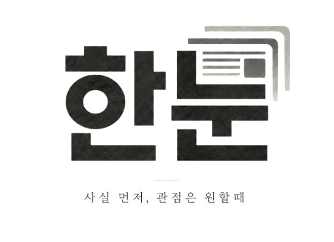
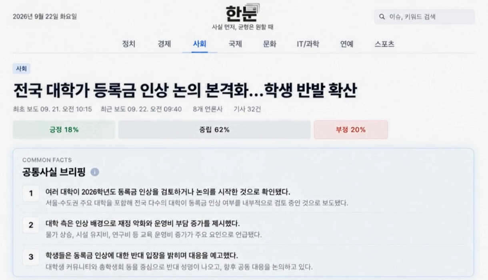
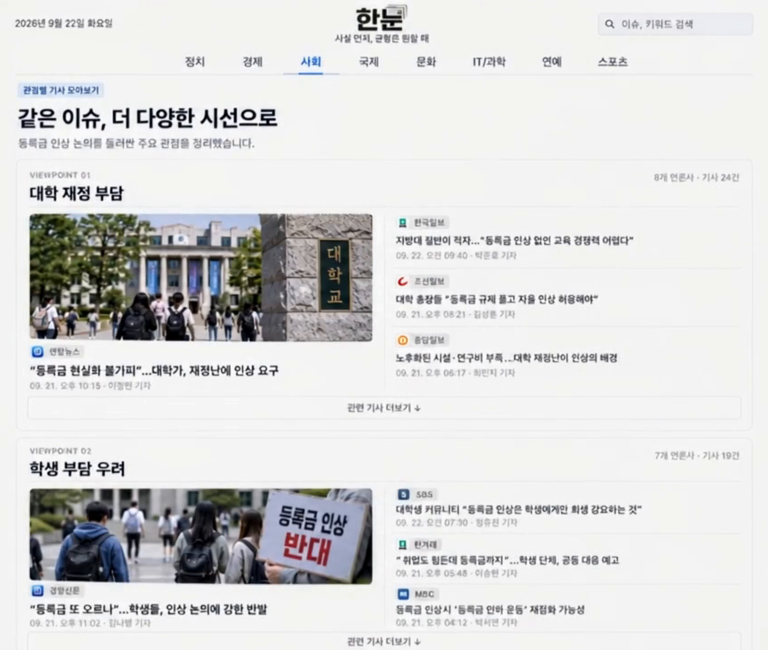
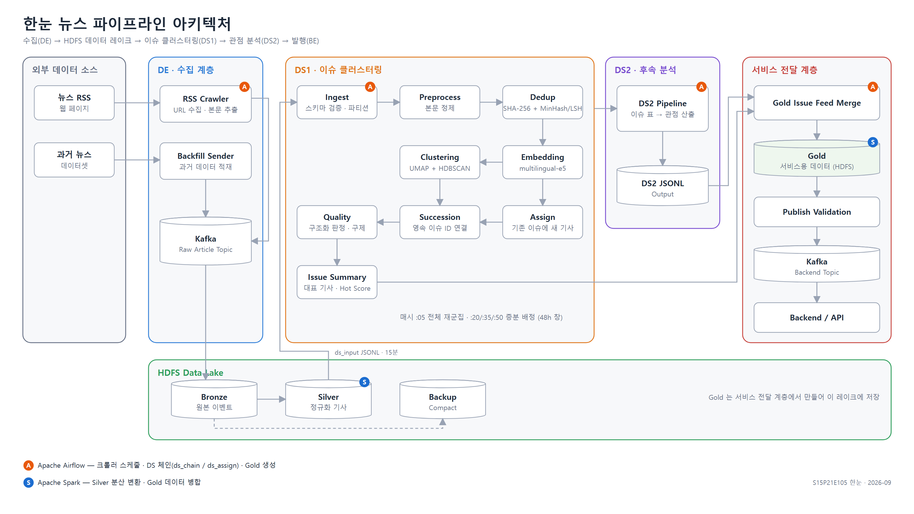

# 📰 한눈 (SSAFY 15기 특화 프로젝트 E105)

 

  
  <h3>같은 사건 뉴스를 관점별로 나눠 보는 서비스</h3>
  

## ⌨️ 기간

- **2026.08.18 ~ 2026.09.28 (6주)**

 

## 🔎 목차

1. <a href="#subject">🎯 주제</a>
1. <a href="#mainContents">⭐️ 주요 기능</a>
1. <a href="#systemArchitecture">⚙ 시스템 아키텍처</a>
1. <a href="#skills">🛠️ 기술 스택</a>
1. <a href="#troubleshooting">🧯 데이터 파이프라인 트러블슈팅</a>
1. <a href="#folders">📁 폴더 구성</a>

 

<!------- 주제 -------->

## 🎯 주제

**한눈**은 뉴스를 **이슈로 묶고**, 이슈 안에서 **언론사별 관점(긍정, 중립, 부정)** 과 **공통 사실**을 한눈에 보여 줍니다.

13개 언론사 RSS를 15분마다 수집해 자동으로 묶고, 매시간 다시 정리합니다.

**주요 기능**

- 같은 사건 기사 묶기
- 관점 비율과 공통 사실 브리핑
- 관점별 기사 모아보기

<a href="#tableContents">목차로 이동</a>

 

<!------- 주요 기능 -------->

## ⭐️ 주요 기능

### 이슈 상세

<h4>한 사건을 다룬 기사들을 하나의 이슈로 묶고, 관점 비율과 공통 사실을 보여 줍니다.</h4>

- 최초 보도와 최근 보도 시각, 참여 언론사 수, 기사 수
- 긍정, 중립, 부정 비율
- 언론사들이 공통으로 확인한 사실을 3줄로 정리한 공통 사실 브리핑

---

### 관점별 기사 모아보기

<h4>같은 이슈를 바라보는 서로 다른 시선을 묶어서 보여 줍니다.</h4>

- 관점마다 대표 기사와 참여 언론사
- 관련 기사 더보기

<a href="#tableContents">목차로 이동</a>

 

<!------- 아키텍처 -------->

## ⚙ 시스템 아키텍처

서버 두 대. **A**(`j15e105a`)는 수집, 저장, 분석. **B**(`j15e105`)는 서비스, DB, 모니터링, 배포.

<a href="#tableContents">목차로 이동</a>

 

<!------- 기술 스택 -------->

## 🛠️ 기술 스택

**Data**

**Backend, Frontend, Infra**

<a href="#tableContents">목차로 이동</a>

 

<!------- 트러블슈팅 -------->

## 🧯 데이터 파이프라인 트러블슈팅

| 문제 | 원인 | 해결 | 결과 |
| --- | --- | --- | --- |
| 과거 기사 1,110만 건 적재가 1시간 만에 중단 | 원본에 날짜 형식 3가지가 섞임. 파이썬 변환 함수의 예외 하나가 잡 전체를 멈춤 | 7개 파일 전수 집계 후 3가지 형식 대응, 못 읽는 행만 빼고 건수 기록 | 1,110만 건 적재 |
| 파일 545,600개로 쪼개져 쓰기 커밋 30분 | 중복 제거 셔플 키와 날짜 파티션 키가 달라 날짜마다 파일 195개 | 쓰기 직전 `repartition("dt")` | 날짜당 1개, 6초 |
| 분석 결과 절반이 서비스 데이터와 결합 실패 | 날마다 다시 계산하는 창이 섞여 같은 이슈 번호가 다른 사건을 가리킴 | 창 하나를 통째로 결합, 없는 창이면 멈춤 | 결합률 47.8%에서 97.2% |
| 폴더 2,814개를 훑는 분석팀 입력 추출 | 실버 층이 폴더 단위 Parquet | 운영 중단 없이 Iceberg로 단계 전환, 건수 두 번 대조 | 46.6초에서 20.1초 |

<a href="#tableContents">목차로 이동</a>

 

<!------- 폴더 -------->

## 📁 폴더 구성

| 폴더 | 담당 | 시작할 때 볼 것 |
|---|---|---|
| `front/` | FE | `front/README.md` |
| `back/` | BE | `back/README.md`, `back/deploy/` |
| `data/de/` | DE | `data/de/infra/README.md`, `data/docs/ec2-a-access.md` |
| `data/ds/` | DS1, DS2 | `data/ds/README.md`, `data/ds/docs/ds1/EC2_RUNBOOK.md` |
| `data/docs/` | 데이터 파트 공통 | 브랜치와 커밋 규칙, 파트 간 데이터 계약 |
| `infra/` | 전체 | `Jenkinsfile`. `develop` 머지 시 자동 배포 |
| `exec/` | 전체 | **포팅 매뉴얼**. 처음부터 다시 올리는 법, 외부 서비스, DB 덤프, 시연 순서 |

**처음 클론했다면**

1. 자기 파트 폴더의 README부터
2. 서버에 올려야 하면 `exec/01_빌드_및_배포.md`
3. 브랜치는 자기 파트 dev(`front/dev`, `back/dev`, `data/dev`)에서 따고 거기로 MR. 이름, 커밋, MR 규칙은 `data/docs/GIT_CONVENTION.md`

> 프로젝트 기간 동안 운영한 서버(j15e105.p.ssafy.io)는 SSAFY 과정의 프로젝트 종료 후 반납되어 지금은 접속되지 않습니다.

<a href="#tableContents">목차로 이동</a>

